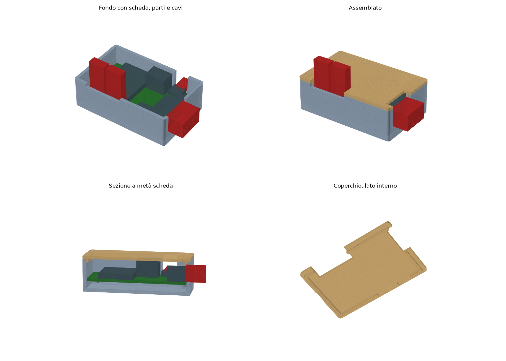

# Involucro stampato in 3D per il nodo 503 (rev C)

Scatoletta in due pezzi (fondo + coperchio a scatto) per la scheda `nodo503`, da appoggiare sul fondo della scatola 503 dietro i frutti. Come la scheda, è **generata da uno script**: non modificare gli STL a mano, cambia i parametri in `gen_case.py` e rigenera.



## File

| File | Cosa contiene |
|---|---|
| `gen_case.py` | Generatore parametrico. Legge dimensioni e fori da `../design.py` e la posizione dei connettori dai courtyard di `../nodo503.kicad_pcb`, quindi segue la scheda se viene rigenerata. |
| `nodo503_case_base.stl` | Fondo, già orientato per la stampa (apertura verso l'alto). |
| `nodo503_case_lid.stl` | Coperchio, già capovolto per la stampa (faccia esterna sul piano). |
| `anteprima_case.png` | Fondo con scheda e ingombri, assemblato, sezione, coperchio dal lato interno. |

Per rigenerare (da `hardware/nodo503/case/`, gira anche su macOS, non serve KiCad):

```bash
pip install manifold3d numpy matplotlib
python3 gen_case.py
```

Lo script stampa le dimensioni esterne e controlla che fondo e coperchio non tocchino scheda, componenti, spine e cavi modellati: se trova un'interferenza la elenca ed esce con errore.

## Com'è fatto

- **Esterno 59,6 × 38,1 × 20,2 mm**, pareti 1,8 mm, fondo 2 mm, coperchio 1,6 mm. Gioco di 0,5 mm tra bordo della scheda e pareti.
- **Fissaggio della scheda:** due colonnine Ø 5,2 mm sotto i fori M2,5 (dentro il keepout di 2,8 mm), con foro cieco Ø 2,2 mm per **viti autofilettanti M2,5 × 6 a testa cilindrica** (per plastica, tipo PT/DIN 7985). Per un inserto filettato a caldo M2,5 porta `PILOT_D` a 3,6. La scheda sta 4 mm sopra il fondo (i pin THT sporgono ~2 mm). Due appoggi Ø 3,2 mm sotto gli angoli senza vite (antenna in alto a sinistra, J1 in basso a destra) impediscono che la scheda basculi.
- **Coperchio a scatto:** un bordino interno da 2 mm centra il coperchio; quattro piccole bugne (0,4 mm) scattano in incavi nelle pareti. Una tacca sul lato sinistro serve a sollevarlo con un cacciavite. Il bordino è interrotto sopra il K7805, che arriva quasi al coperchio.
- **Aperture:**
  - **J1 (bus):** finestra sul lato destro, dal piano della scheda in su: la spina KF2EDGK si innesta e sporge di ~11 mm fuori dalla scatoletta, con i fili che escono di lato.
  - **J2 (Qwiic):** tacca nella parete superiore, all'altezza della presa.
  - **J3/J4 (pulsanti):** fessura nel coperchio sopra i due JST PH, aperta verso il bordo inferiore, così il coperchio si chiude con i cavi già innestati. I fili salgono verso i frutti (o escono di lato dalla tacca nella parete).
  - **J5:** nessuna apertura. La prima programmazione si fa a coperchio aperto, poi si aggiorna via OTA.
- **Antenna:** solo plastica davanti all'antenna del modulo. Non usare filamenti caricati con metallo o carbonio.

## Stampa

- PETG (consigliato: dietro i frutti può scaldarsi) o PLA, ugello 0,4, strato 0,2 mm, 3 perimetri, nessun supporto.
- Fondo con l'apertura verso l'alto, coperchio con la faccia esterna sul piano: gli STL sono già orientati così.

## Da verificare sulla prima scheda (misure non nel progetto KiCad)

Le altezze dei componenti sono nella tabella `PARTS` di `gen_case.py` e vengono dai datasheet o da stime. Misurale con il calibro su una scheda assemblata e, se servono, correggi i parametri e rigenera:

1. ~~Altezza del K7805-500R3~~: **misurata 10 mm** sulla scheda demo (2026-11-06), come stimato. `TOP_CLEAR` resta 11 mm (1 mm di margine sotto il coperchio).
2. ~~Altezza della presa J1 e della spina innestata~~: **confermate** sulla scheda demo (2026-11-06): 8,6 e 9,5 mm, spina che sporge ~11 mm oltre il bordo.
3. **Profondità libera nella 503** dietro i frutti Vimar Linea: la scatoletta è alta 20,2 mm, più la curva dei cavetti PH sopra il coperchio. Se non c'è spazio, i cavi possono uscire di lato dalla tacca della parete inferiore.
4. **Lunghezza delle viti:** con le colonnine da 4 mm + 2 mm di fondo, una M2,5 × 6 entra 4,4 mm. Non usare viti più lunghe di 6 mm: bucherebbero il fondo.
5. **Scatto del coperchio:** se è troppo duro o troppo lasco, cambia `BUMP_PROUD` (0,4 mm) o `LIP_GAP` (0,2 mm), che dipendono dalla stampante.
